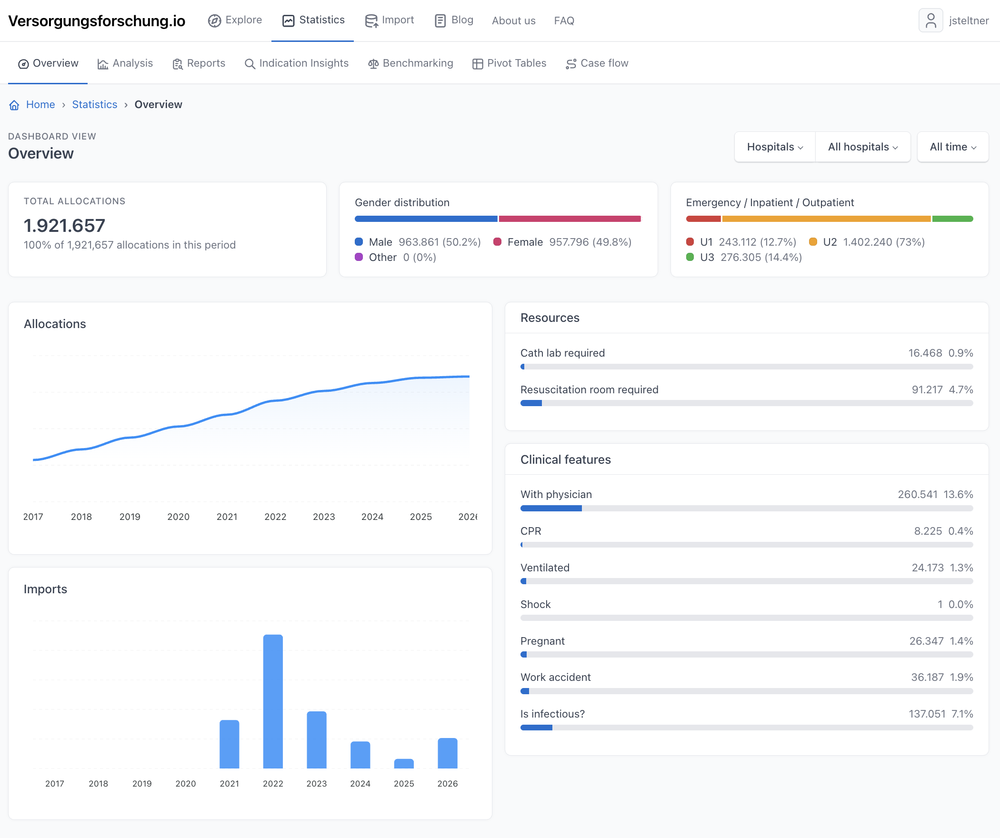

# Collaborative IVENA Statistics

**Making emergency care data accessible for collaborative research.**

[](https://github.com/nplhse/collaborative-ivena-statistics/actions/workflows/tests.yml)
[](https://github.com/nplhse/collaborative-ivena-statistics/actions/workflows/lint.yml)
[](https://codecov.io/gh/nplhse/collaborative-ivena-statistics)

Collaborative IVENA Statistics is an open-source platform for analysing emergency medical service (EMS) hospital allocation data from the German **IVENA eHealth** system.

Developed as a collaborative initiative in Hesse, Germany, the project brings together routinely collected data from participating hospitals to better understand emergency patient flows, explore patterns in clinical care, and support multicentre emergency care research.

**[Explore the platform](https://versorgungsforschung.io)** (login required) - **[Documentation](docs/README.md)** - **[Contributing](CONTRIBUTING.md)**



## Why this project exists

Every day, emergency medical services coordinate the transport of patients to hospitals. These decisions generate valuable information about emergency care: where patients are transported, how urgently they require treatment, which clinical resources are requested, and how demand changes over time.

Yet these data often remain fragmented across individual institutions, limiting their potential for broader analysis.

**Collaborative IVENA Statistics aims to make better use of information that already exists.**

By combining and standardising anonymised routine data, the platform enables participating hospitals and researchers to examine emergency care beyond the boundaries of individual institutions.

The project pursues three complementary goals:

- **Understand emergency care:** Identify patterns in patient flows, clinical characteristics, resource requirements, and temporal trends.
- **Support participating hospitals:** Provide accessible statistics and meaningful comparisons with other care settings.
- **Enable collaborative research:** Establish a consistent data foundation for investigating questions in emergency medicine and healthcare delivery.

The underlying principle is simple: valuable research should not always require additional documentation when relevant data are already collected during routine care.

## What can you explore?

- **Patient flows and clinical characteristics:** How patients are allocated to hospitals, broken down by demographics, urgency, suspected diagnoses, transport characteristics, and requested clinical resources.
- **Hospital benchmarking:** Allocation patterns compared across care levels, geographic settings, and hospital sizes. Benchmarking is intended to support understanding and research, not to establish simplistic hospital rankings.
- **Clinical indications:** Individual indications and how their demographics, urgency, resource requirements, and temporal patterns differ across hospitals.
- **Hospital availability:** Availability restrictions and temporary department closures, and how allocation patterns change around them.
- **Flexible data exploration:** The Analysis Explorer offers configurable time series, distributions, ranked lists, and cross-tabulations with filters, without requiring database queries or statistical code.

## From routine data to research

The platform supports a collaborative workflow built around existing IVENA exports:

1. **Import:** Participating hospitals contribute anonymised IVENA allocation data through a structured import process.
2. **Standardise:** Imported records are validated, processed, and mapped to consistent data structures to enable comparisons across institutions.
3. **Explore and investigate:** Interactive analyses make patterns and temporal developments accessible and provide a data foundation for research questions such as:
   - How does emergency care demand change throughout the day, week, or year?
   - How do emergency patient populations differ across hospital care levels or between urban and rural hospitals?
   - How do urgency and resource requirements vary between clinical indications?
   - How frequently are specialised resources, such as resuscitation rooms or cardiac catheterisation laboratories, requested?
   - How do changes in hospital availability relate to patient flows?

These examples illustrate possible applications of the data and do not imply that every question can be answered directly or causally using routine allocation records alone.

## Collaboration and data access

Collaborative IVENA Statistics was initiated by members of the Hesse working group of the German Society for Interdisciplinary Emergency and Acute Medicine (DGINA), with the aim of making routine emergency care data more useful for participating institutions and scientific research.

The platform is designed for clinicians, researchers, participating hospitals, and developers interested in emergency care analytics. Hospitals and researchers interested in participating can find more information on the [project website](https://versorgungsforschung.io).

**Open-source software does not mean open access to clinical data.**

The application source code is publicly available, but real clinical datasets are not distributed through this repository. Access to imported data and analytical functionality is subject to the platform's permissions and applicable data protection requirements.

Synthetic demonstration data can be used for local development without requiring access to real patient records.

> **Disclaimer:** This is an independent project. It is not affiliated with, endorsed by, or operated on behalf of the provider of IVENA eHealth, the Hessian state ministry responsible for health, or any other public authority.

## Technology

| Component | Technology |
|---|---|
| Backend | PHP 8.4+, Symfony 8 |
| Database | PostgreSQL 18 |
| Persistence | Doctrine ORM |
| Frontend | Twig, Symfony UX, Stimulus |
| Interface | Tabler (Bootstrap) |
| Visualisation | ApexCharts |
| Background processing | Symfony Messenger |
| Testing | PHPUnit |

## Getting started

### Requirements

- PHP 8.4 or newer and [Composer](https://getcomposer.org/)
- [Symfony CLI](https://symfony.com/download)
- Docker with Docker Compose (provides PostgreSQL 18 and Mailpit), or your own PostgreSQL 18 instance
- Node.js and npm (development only, used for ESLint)

### Local installation

```bash
git clone https://github.com/nplhse/collaborative-ivena-statistics.git
cd collaborative-ivena-statistics
cp .env.example .env.local
```

Set at least `APP_SECRET` and `DATABASE_URL` in `.env.local`. You can generate a secret with:

```bash
php -r "echo bin2hex(random_bytes(16)), PHP_EOL;"
```

Start the containers first, then install the application. `make install-dev` creates a fresh development database with demonstration fixtures and a test database:

```bash
make start
make install-dev
```

Then start the web server and the Messenger workers for asynchronous jobs and scheduled tasks:

```bash
symfony serve -d
make consume
```

`make start` builds the Docker images without cache, so the first run can take a few minutes. If you run PostgreSQL yourself, skip it.

**Important:** `make install-dev` drops and recreates the development database. If the database already holds an installation, it stops unless you add `INSTALL_CONFIRM=yes`. To keep an existing database, use `make upgrade-dev` instead.

| Goal | Command |
|---|---|
| Fresh dev setup with fixtures | `make install-dev` |
| Empty database, prod-like setup | `make install` |
| Update code and schema, keep data | `make upgrade-dev` or `make upgrade-prod` |
| Clear runtime files, drop and recreate the database | `make purge` |
| Same as `purge`, plus demo fixtures | `make reset` |

For configuration options and development workflows, see the [local setup guide](docs/01-getting-started/local-setup.md), the [configuration reference](docs/06-reference/configuration.md), and the [documentation index](docs/README.md).

## Contributing

The project benefits from collaboration between clinicians, researchers, and software developers.

Contributions are welcome, whether they involve improving data processing, extending analytical capabilities, refining the user experience, fixing bugs, or improving documentation.

Please read the [contribution guidelines](CONTRIBUTING.md) and [code of conduct](CODE_OF_CONDUCT.md) before getting started.

## License

This project is licensed under the MIT License. See [LICENSE.md](LICENSE.md) for details.
